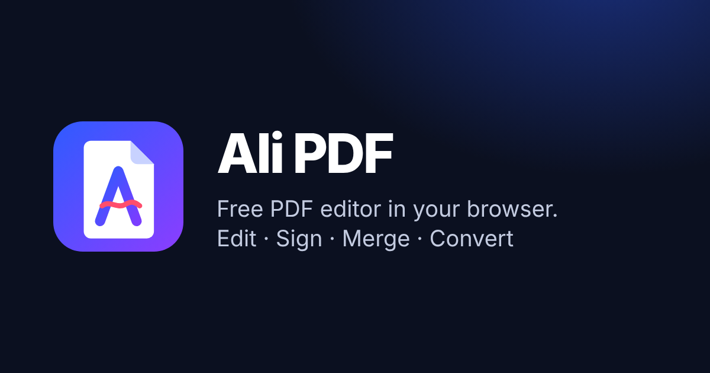

# Ali PDF

**A free PDF editor that runs in your browser.**

### ▶ Open Ali PDF: https://hassanaliarshad110.github.io/ali-pdf/

## What it does

Ali PDF covers the everyday work people usually pay a monthly subscription for:

| | |
|---|---|
| **Organize** | Merge, split, extract, insert, reorder, rotate, crop and delete pages |
| **Edit & annotate** | Edit existing text, add text, highlight, draw, shapes, images, comments, whiteout, redact, watermark, page numbers |
| **Sign & forms** | Draw, type or upload a signature, stamps (Approved, Paid, Draft…), fill form fields, add dates |
| **Convert** | PDF to Word, Excel (.csv), JPG, PNG, text and HTML; images to PDF |
| **OCR** | Recognize text in scanned pages and photos (English, Arabic, Urdu and more) so you can search, copy, edit and convert it |
| **Optimize & protect** | Compress, remove a password, flatten, edit properties |

## Keyboard shortcuts

| Keys | Action |
|---|---|
| **← / →** | Previous / next page |
| **Home / End** | First / last page |
| **Page Up / Page Down / Space** | Scroll one screen |
| **Ctrl + Shift + → / ←** | Rotate page right / left |
| **Ctrl + 0 / 1 / 2** | Fit page / actual size / fit width |
| **Ctrl + Plus / Minus** | Zoom in / out |
| **Ctrl + F**, **F3** | Find, next result |
| **Ctrl + Shift + N** | Go to page |
| **Ctrl + P / S / O** | Print / save / open |
| **Ctrl + Z / Y** | Undo / redo |
| **Ctrl + Shift + D** | Delete page |
| **Ctrl + D** | Document properties |
| **F4** | Show or hide the side panel |

## Private by design

Your files never leave your device. Everything happens inside your browser. Nothing is uploaded to a server.

## Install it as an app

Ali PDF can be installed like a desktop or phone app, and works offline after the first visit.

- **Windows / Mac (Chrome or Edge):** open the link above, then click **Install app** in the top bar (or the install icon in the address bar).
- **Android (Chrome):** open the link, tap **⋮**, then **Add to Home screen / Install app**.
- **iPhone (Safari):** open the link, tap **Share**, then **Add to Home Screen**.

## Built by

**Hassan Ali**, accountant and builder exploring how AI changes the way businesses get their software.

Ali PDF is free to use. If it saves you a subscription, share it with someone who needs it.
